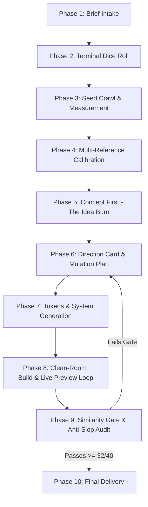

# 🎲 Taste Engine v3 `(Antigravity Edition)`

> **Zero tolerance for template-looking output.**  
> Designs distinctive, Awwwards / Godly-level websites, landing pages, and interactive product UIs with real kinetic motion from just an idea and an audience.

[](https://github.com/lakshya1282/taste-engine)
[](LICENSE)
[](https://awwwards.com)
[](#the-anti-slop-manifesto)

---

## ⚡ The Elevator Pitch

Most AI-generated web designs look like an AI generated them.  
They collapse into predictable templates: either the **Gen 1** gradient-purple SaaS landing page or the **Gen 2** dark-mode faux-luxury layout with gold accents, numbered `01 02 03` links, and decorative coordinates.

**Taste Engine breaks this cycle.**

Instead of guessing from frozen training memory, Taste Engine:
1. **Rolls random dice** in the terminal to pick an award-winning seed site from live design archives (Awwwards, Godly, Land-book, Siteinspire).
2. **Politely crawls and programmatically measures** real CSS tokens, WAAPI animations, transition timings, and layout rhythms in the browser.
3. **Applies stochastic mutation operators** so the final product inherits the seed's raw craft and kinetic feel—**never its identity or code**.
4. **Burns your first two ideas** (which are always generic).
5. **Enforces clean-room synthesis** and hard similarity gates before a single line of client code is marked done.

---

## 📜 The Anti-Slop Manifesto

### Why Earlier Agent Designs Failed
| Slop Generation | Hallmarks & Tells | Taste Engine Counter-Measure |
| :--- | :--- | :--- |
| **Gen 1 Slop** | Aurora background blobs, purple/indigo linear gradients, glassmorphism cards, centered hero with two identical pill buttons, generic 3-column feature grid. | Strict layout skeletons, bespoke color logic, zero glassmorphism without physical rationale. |
| **Gen 2 Slop** | Near-black (`#0a0a0a`) background, champagne/gold accent, serif + extended sans headline stack, tiny uppercase mono labels with `//` or `[brackets]`, fake live clocks, fake coordinates, 3-stat vanity strip, "monolith / atelier / sanctuary" buzzwords. | Mandatory chromatic darks or tactile light paper surfaces, banned slop font registry, strict copy rules, no vanity stats. |

---

## 🔄 The 10-Phase Pipeline



### 1. Brief Intake (`design/brief.md`)
Captures the emotional fingerprint in 3 seconds, target culture, single conversion goal, banned tropes, and stack (default: semantic HTML + modern CSS + JS with GSAP & Lenis). Asks at most **one** clarifying question.

### 2. Stochastic Mutation Dice (`design/dice.md`)
Runs an unbiased Python script in the terminal that outputs:
- **Seed Source Gallery:** Awwwards Site of the Day, Godly, Land-book, Siteinspire, Minimal Gallery, Supahero, etc.
- **Seed Position:** Random page and offset.
- **Inherited Anchors:** Exactly 3 dimensions sampled from `{motion language, color relationships, type hierarchy, spacing rhythm, interaction mechanics}`.
- **Forced Mutations:** Layout skeleton, background rule, palette logic, type personality, and an extra disruptive constraint (e.g. *no cards*, *no rounded corners*, *giant interactive footer*).

### 3. Polite Crawl & Numeric Measurement (`design/design.md`)
Extracts exact numbers using headless browser console injection—no guessing:
```javascript
// Example: Extract real computed styles and font loads
const fonts = [...document.fonts].map(f => `${f.family} ${f.weight} ${f.style}`);
const computedType = ['h1','h2','p','button'].map(sel => {
  const el = document.querySelector(sel);
  if (!el) return null;
  const s = getComputedStyle(el);
  return { sel, family: s.fontFamily, size: s.fontSize, weight: s.fontWeight, lh: s.lineHeight };
});
```
Measures real Web Animations API (WAAPI) curves, GSAP ScrollTrigger trigger points, and transition easings (`expo.out`, `power3.inOut`, custom cubic beziers).

### 4. Reference Scan
Pulls 4–6 cross-industry references (record label drops, indie games, zines, fashion archives) to calibrate craftsmanship and find the visual white space.

### 5. Concept First: The Idea Burn (`design/concept.md`)
1. Generates 5 distinct physical world metaphors (e.g., subway transfer pass, contact sheet, vintage telemetry terminal, risograph zine).
2. **Deletes Ideas 1 and 2 immediately** (they are the obvious AI slop).
3. Selects from ideas 3–5 using the rolled constraint as a tiebreaker.

### 6. Direction Card (`design/direction.md`)
A locked contract containing:
- Concept statement
- Seed URL (credited for inspiration)
- The 3 inherited craft anchors vs. the mutated dimensions
- 3 signature moments visitors will screenshot
- Slop avoidance checklist

### 7. Token Synthesis (`design/tokens.md`)
Transforms measurements and mutations into clean CSS custom properties. Curates fresh typography from live sources (Fontshare, Velvetyne, Collletttivo, Google Fonts non-top-tier).

### 8. Clean-Room Build & Live Preview Loop
- **First Viewport Discipline:** Max 5 distinct elements. One loud idea, the rest quiet.
- **Strict Clean Room:** The seed's HTML/CSS/JS is never copied. All motion and styles are built from scratch.
- **Mobile First-Class:** Mobile layouts are designed with distinct interactions, not just stacked cards.
- **Continuous Preview:** Agent spins up local server, scrolls via headless browser, takes full-page desktop (1440px) and mobile (390px) screenshots.

### 9. Verification & Similarity Gates
Before shipping, the build must pass three strict quality audits:
- **Similarity Gate:** Screenshots placed side-by-side with the seed. Must be clearly distinct across at least 4 of 6 dimensions (concept, structure, dominant color, type, media, interaction).
- **Slop Scan:** -1 penalty for every AI cliche (gradient blobs, floating badges, vanity stats, buzzwords).
- **Parity Test & 40-Point Scorecard:** Concept clarity, distinctiveness, craft, and motion purpose. Minimum score to pass: **32 / 40**.

### 10. Delivery
Outputs the direction card, credited seed, live preview instructions, scorecard, and placeholders.

---

## 🚫 The Anti-Slop Blacklist

### ❌ Banned Typography (Default Choices)
These fonts are banned as primary/secondary selections unless explicitly justified by the seed teardown:
> `Inter`, `Roboto`, `Poppins`, `Montserrat`, `Open Sans`, `Space Grotesk`, `DM Sans`, `Instrument Serif`, `Playfair Display`, `Cormorant`, `DM Serif Display`, `Syne`, `Unbounded`, `Clash Display`, `Cabinet Grotesk`, `General Sans`, `Satoshi`, `Bricolage Grotesque`, `Manrope`, `Outfit`, `Plus Jakarta Sans`, `JetBrains Mono`, `Geist Mono`, `Departure Mono`.

### ❌ Banned Buzzwords
> *Revolutionize, supercharge, seamless, unlock, elevate, game-changing, cutting-edge, empower, next-level, all-in-one, monolith, sanctuary, atelier, dossier, curated, bespoke, "crafted for those who..."*

---

## 💻 Installation & Usage

### Option 1: Use with Google Antigravity
Clone or copy this repository into your Antigravity skills directory:

```bash
# Global skills directory
git clone https://github.com/lakshya1282/taste-engine.git ~/.gemini/antigravity/skills/taste-engine

# Or into an active project workspace
git clone https://github.com/lakshya1282/taste-engine.git .gemini/skills/taste-engine
```

### Option 2: Use with Claude Code / Cursor / Windsurf / Codex
Taste Engine is fully self-contained in markdown. Copy [`SKILL.md`](SKILL.md) into your agent's instructions or skills folder:

```bash
# Agent directory (e.g., .agents/skills)
mkdir -p ~/.agents/skills/taste-engine
cp SKILL.md ~/.agents/skills/taste-engine/SKILL.md
```

### Triggering the Skill
Prompt your agent naturally:
```text
"Design an interactive portfolio site for an experimental audio software studio. 
Target audience: electronic music producers and synth nerds. 
Use the taste-engine skill."
```

Or invoke the command:
```text
/taste-engine "Editorial landing page for a specialty Japanese knife maker"
```

---

## 📁 Repository Structure

```
taste-engine/
├── SKILL-antigravity-v3.md   # The complete Taste Engine v3 specification
├── SKILL.md                  # Standardized agent skill entrypoint
└── README.md                 # Interactive documentation & guide
```

---

## 🎲 Try the Mutation Roll Locally

You can test the exact dice roll logic anytime with Python:

```bash
python -c '
import random
R = random.choice
print("SEED SOURCE:", R(["awwwards.com SOTD", "godly.website", "land-book.com", "siteinspire.com", "minimal.gallery"]))
print("PAGE:", random.randint(1, 4), "| POSITION:", random.randint(1, 20))
print("INHERITED ANCHORS:", random.sample(["motion language", "color relationships", "type hierarchy", "spacing rhythm", "interaction mechanics"], 3))
print("BACKGROUND:", R(["warm light paper tone", "chromatic dark (oxblood, ink blue)", "two-tone split", "pure white with heavy ink"]))
print("EXTRA CONSTRAINT:", R(["no rounded corners", "no cards", "navigation is not a top bar", "giant interactive footer", "first viewport max 4 elements"]))
'
```

---

## 👤 Author & Credits

- **Curated & Maintained by:** [Lakshya Parmar](https://github.com/lakshya1282)
- **Inspiration:** The world-class creative engineering seen on [Awwwards](https://awwwards.com), [Godly](https://godly.website), and [Siteinspire](https://siteinspire.com).

*Crafted for creators who refuse to let AI standardize the web.*
